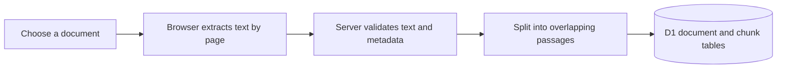
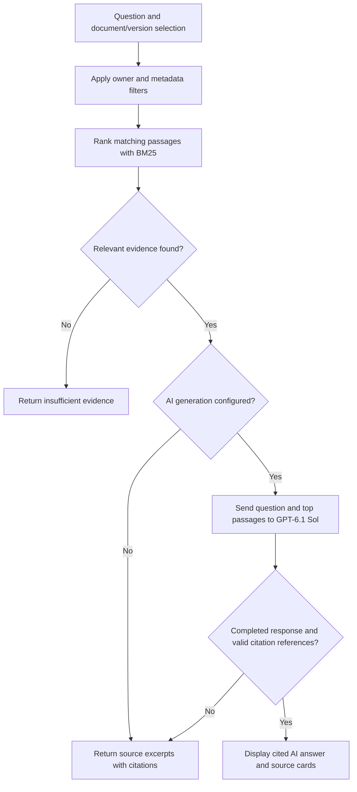

# Folio — Document Assistant

Folio helps you find and understand information inside a collection of documents. Upload PDF, Markdown, or text files, ask a question, and inspect the passages behind the response—including their document version and page.

The app combines **retrieval-augmented generation (RAG)** with an evidence panel. It searches your documents first, then optionally asks **GPT-6.1 Sol (`gpt-6.1-sol`) through AI Space** to write an answer using the retrieved text. Source search also works without an AI API key.

This repository contains the application source and empty configuration examples. API keys, uploaded documents, local databases, and the original hosting project identity are excluded.

## Contents

- [Use cases](#use-cases)
- [Features and answer modes](#features-and-answer-modes)
- [Run locally](#run-locally)
- [Enable GPT-6.1 answers](#enable-gpt-61-answers)
- [Using the app](#using-the-app)
- [How the workflow works](#how-the-workflow-works)
- [Why manual training labels are not required](#why-manual-training-labels-are-not-required)
- [Architecture and storage](#architecture-and-storage)
- [API overview](#api-overview)
- [Testing and evaluation](#testing-and-evaluation)
- [Configuration, privacy, and deployment](#configuration-privacy-and-deployment)
- [Limits and troubleshooting](#limits-and-troubleshooting)
- [Project structure and next steps](#project-structure-and-next-steps)

## Use cases

Folio is useful when the answer exists in your reference material, but finding the right passage takes time.

| Use case | Documents to upload | Example question |
| --- | --- | --- |
| Software documentation | API guides, integration notes, migration checklists | “What is the request rate limit?” |
| Course and study material | Lecture notes, readable PDFs, Markdown summaries | “How does the guide explain deadlock prevention?” |
| Personal operations handbook | Runbooks, setup instructions, troubleshooting guides | “What steps are listed for restoring a backup?” |
| Versioned reference material | Two releases of the same guide or policy | Select a release, then ask “How long do access tokens last?” |

The version filter is particularly useful when older and newer documents give different answers. Select the version explicitly; mentioning a version in the question does not change the filter automatically.

Folio currently provides an individual document library. Shared team workspaces, live website crawling, and automatic synchronization with external document services are future work.

## Features and answer modes

- Import selectable-text PDFs, Markdown, and plain text.
- Organize documents with a title and version.
- Keep a persistent library and remove documents when no longer needed.
- Search selected documents and versions using a BM25-style keyword ranker.
- Open numbered citations to inspect exact retrieved text, source title, version, page, and section.
- Inspect request timing and the number of passages searched.
- Load fictional sample documentation and run a repeatable retrieval benchmark.

Each question produces one of three modes:

| Mode | When it appears | What you receive |
| --- | --- | --- |
| **Source search** | Relevant passages exist, but AI generation is not configured or cannot complete successfully | Extracted source sentences with numbered references |
| **Cited AI answer** | Relevant passages exist and the configured provider returns an accepted response | An AI-written answer with references to retrieved passages |
| **Insufficient evidence** | The retriever finds no usable matches | A message suggesting a more specific question, different selection, or additional document |

Source search is an extractive baseline: it selects sentences from the documents. AI mode adds synthesis and explanation. If there are no retrieved passages, the app does not send a generation request.

## Run locally

### Prerequisites

- **Node.js 22.19 or newer**, with npm. This is the recommended baseline for the included TypeScript and SQLite tests.
- Git, if cloning the repository.
- A browser capable of running PDF.js.
- Access to this GitHub repository; it is currently private.

You do not need an AI API key or a Cloudflare account to try local source search. The development runtime simulates Cloudflare services on your computer.

### 1. Clone and install

```sh
git clone https://github.com/Grimshock1015/folio-document-assistant.git
cd folio-document-assistant
npm ci
```

`npm ci` installs the dependency versions recorded in `package-lock.json`.

### 2. Prepare the local database

```sh
npm run setup
```

This command:

1. Copies the matching PDF.js worker into `public/`.
2. Creates an ignored local migration configuration.
3. Applies pending database migrations to the local D1 database.

The database lives in `.wrangler/state`. Running setup again applies only pending migrations and preserves existing documents. You do not need to create tables manually.

### 3. Start development

```sh
npm run dev
```

Open the **Local** URL printed in the terminal, normally `http://localhost:5173`.

The development server simulates sign-in for loopback requests, so you can use the local app without connecting a ChatGPT account. That development sign-in behavior is excluded from production builds.

To select a different local port:

```sh
npm run dev -- --port 5174
```

## Enable GPT-6.1 answers

Source search works immediately after setup. To enable generated answers, supply your own AI Space credentials on the server.

### 1. Create a local configuration file

On Windows PowerShell:

```powershell
Copy-Item .dev.vars.example .dev.vars
```

On macOS or Linux:

```sh
cp .dev.vars.example .dev.vars
```

### 2. Edit `.dev.vars`

The configuration has these fields:

```dotenv
LLM_PROVIDER=aispace
AISPACE_API_KEY=
AISPACE_BASE_URL=https://ai.xyspace.dev/v1
AISPACE_MODEL=gpt-6.1-sol
```

Enter your key after `AISPACE_API_KEY=` in your **local `.dev.vars` file**. The empty value above is intentional. Do not put a real key in this README, `.dev.vars.example`, frontend code, or a commit.

Your AI Space account must permit the selected model. Model access and billing are handled by that provider.

### 3. Restart the development server

Restart `npm run dev` after changing the environment file. Folio checks its server configuration to decide whether generation is available.

The backend sends non-streaming requests to `https://ai.xyspace.dev/v1/responses`. The model configuration is shared by the status and question endpoints, so both select the same provider and model.

An earlier Anthropic adapter remains available for explicitly configured deployments using `LLM_PROVIDER=anthropic` and `ANTHROPIC_API_KEY`. The default AI Space model is GPT-6.1 Sol. Provider or model failures do not silently switch to another model.

## Using the app

### Try the sample collection

1. Click **Load sample collection**.
2. Select **v2.0** in the version dropdown.
3. Ask **“What is the request rate limit?”**
4. Click a numbered citation to inspect its source.
5. Start a new question, select **v1.0**, and ask the same question.

The fictional Atlas guides specify 300 requests per minute per workspace for v2.0 and 100 requests per minute per API key for v1.0. The different scopes and values make version filtering easy to demonstrate.

The sample import is idempotent: loading it again does not duplicate existing sample documents. The Atlas material is a test fixture, not documentation for a real product.

### Upload your own material

1. Click **Add documents** and choose or drop supported files.
2. Review each title and version. The UI proposes a title from the filename and an initial version.
3. Click **Import** and wait for extraction and saving to finish.
4. Select the documents you want to search.
5. Ask a self-contained question and inspect its citations.

Versions are exact labels: `v2.0` and `2.0` are separate values. Use consistent labels across related documents.

Use the **Library** tab to review document metadata or remove a document. Removing a document also removes its indexed passages.

The conversation stays visible on the current page until you reload or choose **New question**. Earlier exchanges are not automatically sent as context with the next question, and chat history is not saved to the database. Include the relevant details in each question.

## How the workflow works

### A. Document ingestion



1. **Extract text in the browser.** PDF.js reads selectable PDF text. Markdown and text files are read directly and treated as one logical page. Blank PDF pages retain their original page numbers.
2. **Send extracted pages to the backend.** The upload request contains the text plus filename, title, version, and original file size. The original file binary is not saved by this app.
3. **Validate the request.** The server checks the supported extension, input lengths, page order, text limits, and library capacity.
4. **Create chunks.** The chunker builds passages of up to **180 words**, with **32 words of overlap** when a long block spans multiple chunks. It keeps chunks within page and detected section boundaries. Heading detection uses text heuristics.
5. **Store source coordinates.** Each chunk retains its document ID, version, page, section, and text. Owner-scoped database records keep each library separate.

These stored chunks are the app's searchable passage collection. The current implementation reads candidate chunks from D1 and computes ranking in the application; it does not maintain a vector index or a separate search-server index.

### B. Answering a question



1. **Apply filters before ranking.** The backend reads only the signed-in owner's selected documents and exact version, if supplied.
2. **Process the question.** Text normalization lowercases terms, removes common words, and applies simple plural normalization while retaining useful identifiers and numbers.
3. **Score the passages.** The BM25-style ranker considers term frequency, term rarity across candidate passages, passage length, headings, and query-term coverage. These scores rank search results; they are not confidence percentages.
4. **Select evidence.** The question endpoint retrieves up to **five passages**. Conservative overlap checks can reject weak matches, although they cannot prove that the remaining passages answer the question.
5. **Generate or extract.** With a usable provider configuration, the backend sends the question and retrieved passage text and metadata to GPT-6.1 Sol through AI Space. Without generation, it selects up to three relevant source sentences for an extractive response.
6. **Check the generated response.** The Responses adapter requires completed assistant text, excludes reasoning and tool output, rejects refusals, and checks citation references. At least one citation must exist, and every referenced number must point to a supplied passage.
7. **Display the evidence.** Clicking `[1]`, for example, opens the corresponding source card in the interface. Citations show extracted text and coordinates, not an embedded original-PDF viewer.

The model is instructed to answer from the supplied evidence and treat document contents as data rather than instructions. Provider failures, timeouts, incomplete output, and failed citation checks produce a source-excerpt fallback.

A valid citation number establishes that the referenced passage exists in the retrieved set. It does **not** establish that every claim is correct or supported by that passage; inspect the evidence when assessing an answer.

### A small retrieval example

Suppose one passage describes request rate limits and another describes backup retention. For “What is the request rate limit?”, the search terms overlap more strongly with the rate-limit passage, so it should rank higher. GPT then receives the selected evidence rather than every uploaded document.

Because retrieval currently depends on words and identifiers, paraphrases with little keyword overlap can miss the right passage. Embeddings and hybrid retrieval are planned improvements, not features already implemented.

## Why manual training labels are not required

Folio uses a search algorithm and an existing language model. Uploading your documents supplies reference material for retrieval; it does not train or fine-tune a model.

The title and version you enter are **metadata** used for organization and filtering. They are not categories the system must learn to predict.

**Evaluation labels** serve a different purpose. A test can specify:

> Question: “How long do access tokens last?”
>
> Expected evidence: authentication guide, v2.0, page 1, “Token lifetime” section.

That expected source lets you measure whether retrieval worked. Your own uploaded documents remain searchable without creating such labels. The included sample benchmark already has manually specified expected sources.

## Architecture and storage

| Component | Technology | Responsibility |
| --- | --- | --- |
| Interface | React and TypeScript | Ask, Library, Evaluation, upload dialog, filters, source cards |
| PDF extraction | PDF.js | Read PDF text in the browser and preserve page numbers |
| Full-stack runtime | Vinext and Vite | Serve the app and API routes during development and build the Worker |
| Backend | TypeScript on Cloudflare Workers | Validate requests, enforce ownership, retrieve evidence, call the provider |
| Storage | Cloudflare D1, with schema and migrations defined using Drizzle | Persist document metadata and chunk text |
| Retrieval | Custom BM25-style lexical ranking | Rank filtered passages without a separate vector database |
| Generation | GPT-6.1 Sol through AI Space's Responses-compatible endpoint | Write answers using the retrieved evidence |

### What is stored

| Record | Important fields |
| --- | --- |
| `documents` | ID, owner ID, title, version, filename, original byte size, page count, chunk count, creation time |
| `chunks` | ID, document ID, owner ID, ordinal, page, section, extracted text |

Original binaries and conversation history are not stored. Source text is persisted so documents remain searchable across sessions. Local and hosted databases are separate.

Each document import uses an atomic database batch. Multiple files selected in the upload dialog are imported sequentially, so some files can succeed even if a later file fails. The sample collection is imported together in one atomic batch, so a failed sample import does not leave a partial new collection. Database triggers enforce document and chunk quotas during concurrent writes.

## API overview

The routes below are same-origin application endpoints. They require an authenticated identity; local development supplies a simulated identity. Write requests are also checked against cross-origin browser submissions.

| Method | Route | Purpose |
| --- | --- | --- |
| `GET` | `/api/status` | Report whether generation is configured, plus provider/model names; never returns the key |
| `GET` | `/api/documents` | List the current owner's library |
| `POST` | `/api/documents` | Validate and index extracted pages and document metadata |
| `DELETE` | `/api/documents/:id` | Remove an owned document and its chunks |
| `POST` | `/api/ask` | Retrieve evidence and return an AI answer, excerpts, or insufficient evidence |
| `POST` | `/api/demo` | Import the fictional Atlas samples without duplicating existing samples |
| `POST` | `/api/evaluate` | Run the isolated built-in retrieval benchmark |

An illustrative question payload is:

```json
{
  "question": "What is the request rate limit?",
  "documentIds": ["an-id-returned-by-the-library"],
  "version": "v2.0"
}
```

Omit `documentIds` to search the owner's whole library and omit `version` to search all versions. An explicitly empty `documentIds` array is rejected. The UI normally sends the current selection.

The response includes `mode`, `answer`, `sources`, and `metrics`, plus a warning if generation falls back. Metrics include `retrievalMs`, `generationMs`, `totalMs`, and `chunksSearched`. Retrieval timing includes request preparation and database access; it is not an isolated search-algorithm benchmark. Token usage and per-query costs are not currently measured by the app.

## Testing and evaluation

### Commands

```sh
npm run check
npm test
npm run build
```

| Command | What it checks |
| --- | --- |
| `npm run check` | TypeScript types |
| `npm test` | Retrieval, chunking, source coordinates, version isolation, citations, provider parsing/configuration, database quotas, and rollback behavior |
| `npm run build` | Production app and Worker build |
| `npm run test:smoke` | Actual local HTTP routes and persistent local database behavior; requires a running dev server |

The project includes **29 automated tests** in its unit, database, and provider suites. Provider requests in those suites are mocked. A separate live `gpt-6.1-sol` request was verified on November 5, 2026 using a fictional passage and a completed cited answer.

Run the HTTP smoke check in another terminal while `npm run dev` is running:

```sh
npm run test:smoke
```

For a different port:

```sh
node tests/http-smoke.mjs http://127.0.0.1:5174
```

The smoke script refuses non-localhost targets. It loads or reuses the four samples, creates and removes one disposable document, and leaves the sample collection available. If AI generation is configured, its question requests can make real provider calls and incur provider charges. Run it without a key when you want source-search-only HTTP checks.

### The Evaluation tab

The built-in benchmark runs against four fictional Atlas documents in memory. It does not evaluate your current uploaded library and does not require importing samples or configuring a model.

- **Nine answerable cases** have an expected document, page, section, and version.
- **One unsupported question** checks whether retrieval returns no evidence.
- A source lookup passes when its expected passage appears in the **top three** results.
- `recall@3` is the fraction of the nine answerable cases with that expected passage in the top three. The unsupported case is excluded from that denominator.

The initial fixture run passed 10/10 checks with recall@3 of 1.0. These are small known regression fixtures used during implementation, not a held-out estimate of general accuracy or generated-answer quality.

For a more useful portfolio experiment, build a separate manually checked test set from real documentation, then compare the same questions across retrieval strategies. See [EVALUATION.md](EVALUATION.md) for the measurement plan.

## Configuration, privacy, and deployment

### AI Space settings

| Variable | Purpose | Example/default |
| --- | --- | --- |
| `LLM_PROVIDER` | Select the provider explicitly | `aispace` in the supplied example |
| `AISPACE_API_KEY` | Server-side provider credential | Empty in Git; supply locally or as a hosted runtime secret |
| `AISPACE_BASE_URL` | HTTPS API base URL | `https://ai.xyspace.dev/v1` |
| `AISPACE_MODEL` | Model sent in the generation request | `gpt-6.1-sol` |

Without an explicit provider selection, the configuration resolver selects AI Space when its key is present; otherwise it checks the earlier Anthropic configuration. Selecting a provider explicitly does not fall back to another provider when that provider's key is missing.

### Secrets and document data

- `.dev.vars` and `.env*` files are ignored by Git; the tracked examples contain no credentials.
- The browser does not receive the provider key. Generation requests originate on the server.
- AI mode sends the current question and retrieved passage text and metadata to the configured provider. The original PDF binary is not sent to the model by this app.
- AI Space Responses requests include `store: false`; the third-party provider's own data-handling policy still governs its service.
- With no usable provider configuration, no generation request is made. A source-search fallback can also follow an attempted provider request that failed.
- The app does not log prompts, document contents, provider payloads, or keys through its error handler.

### Hosted operation

The original app uses Sites hosting, a Cloudflare Worker, a D1 binding named `DB`, and the platform's authentication gateway. Hosted browser access requires the configured site's sign-in and access policy.

This standalone repository omits the original `project_id`. Its `.openai/hosting.json` retains only logical bindings. A new hosted deployment needs its own project registration, database provisioning, migrations, and server-side runtime variables. Changing hosted environment values requires deploying a version to apply them.

`npm run build` creates the deployable output. `npm start` previews the built Worker locally, but **does not include the Vite development sign-in middleware**. Use `npm run dev` for the complete local interactive experience. Hosting somewhere other than Sites requires integrating a trusted authentication layer; the API currently expects identity headers supplied and verified by that gateway.

Do not expose the development server as a public production service. Local authentication is a development convenience, not a production identity provider.

## Limits and troubleshooting

### Current limits

| Item | Limit |
| --- | --- |
| File formats | `.pdf`, `.md`, `.txt` |
| Original file size | 5,000,000 bytes per file |
| PDF pages | 100 per file |
| Extracted text | 300,000 characters per document |
| Upload selection | Up to 10 files per import batch |
| Indexed chunks | Up to 600 per document |
| Library | Up to 30 documents and 4,000 chunks per owner |
| Question | 1,500 characters |
| Document title / version | 120 / 40 characters |
| Retrieved context | Up to five passages per question |

### Common issues

| Symptom | Explanation and next step |
| --- | --- |
| “Source search mode” remains visible | Check the selected provider and key in `.dev.vars`, then restart the dev server. A non-empty key configures generation; a successful live call also requires provider/model access. |
| `model_not_enabled` or a model-access warning | The account does not permit the configured model. Enable it with the provider or explicitly select a permitted model in server settings. |
| No readable PDF text | The file may be scanned or password protected. Use an unlocked PDF with selectable text, perform OCR externally, or export text. |
| No matching evidence | Check document selection and exact version label, then try terms used in the source. Keyword retrieval can miss paraphrases. |
| Different versions appear in an answer | Select the intended version explicitly. With “All versions,” passages from different releases can be retrieved. |
| Database/table error after cloning | Run `npm run setup` before starting development. |
| PDF worker cannot load | Run `npm run setup` again; `predev` and `prebuild` also copy the matching installed worker. |
| Built Worker requests sign-in but cannot complete it locally | Use `npm run dev`; the built preview expects an authentication gateway. |
| Question relies on an earlier chat exchange | Restate the needed context. Previous conversation turns are not included automatically. |

OCR, DOCX ingestion, structured table/chart interpretation, semantic embeddings, hybrid search, reranking, streaming answers, persistent chats, and shared team workspaces are not implemented in this version. Page/heading extraction and insufficient-evidence detection are heuristic.

## Project structure and next steps

| Path | Responsibility |
| --- | --- |
| [`components/document-assistant.tsx`](components/document-assistant.tsx) | Ask, Library, Evaluation, uploads, filters, citations, source panel |
| [`lib/parse-document.ts`](lib/parse-document.ts) | Browser-side PDF, Markdown, and text extraction |
| [`lib/rag.ts`](lib/rag.ts) | Token processing, chunking, ranking, and extractive answers |
| [`lib/library.ts`](lib/library.ts) | Document validation, owner-scoped persistence, import/delete logic |
| [`lib/generation.ts`](lib/generation.ts) | Provider request, Responses parsing, and citation range checks |
| [`lib/model-config.ts`](lib/model-config.ts) | Shared server-side provider/model selection |
| [`lib/demo.ts`](lib/demo.ts) | Fictional documents and labeled retrieval cases |
| [`app/api/`](app/api/) | HTTP endpoints |
| [`app/chatgpt-auth.ts`](app/chatgpt-auth.ts) | Hosted identity and sign-in helpers |
| [`db/schema.ts`](db/schema.ts) / [`drizzle/`](drizzle/) | Database schema, migration history, and quota guards |
| [`tests/`](tests/) | Unit, database, provider-contract, and HTTP checks |
| [`scripts/setup-local.mjs`](scripts/setup-local.mjs) | PDF worker setup and pending local migrations |
| [`vite.config.ts`](vite.config.ts) / [`worker/index.ts`](worker/index.ts) | Local runtime bindings and hosted Worker entrypoint |

For a code walkthrough, start with the upload and question handlers in `components/document-assistant.tsx`, then follow `/api/documents` into `lib/library.ts` and `/api/ask` into `lib/rag.ts` and `lib/generation.ts`.

The main engineering decisions to discuss are chunk boundaries and overlap, exact version isolation, lexical retrieval tradeoffs, citation validation limits, provider failure handling, ownership boundaries, and transactional imports/quotas.

A practical next step is a held-out evaluation set for one real documentation collection. Use it to compare the existing BM25 baseline with embeddings and hybrid retrieval before adding more pipeline complexity. [ROADMAP.md](ROADMAP.md) describes the next development milestones.
